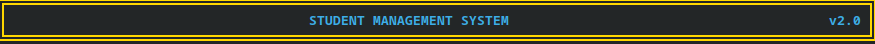
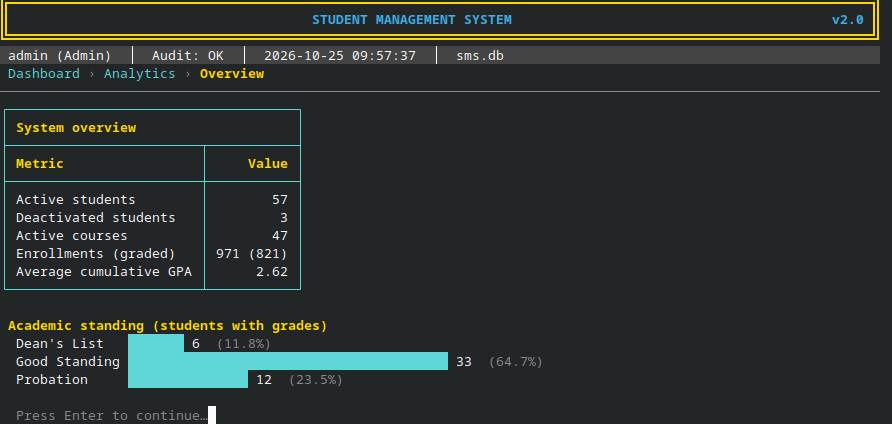

<h1 align="center">
  
</h1>

A complete rewrite of the original single-file `main.cpp` into a layered, tested, production-style
terminal application: role-based access, hashed credentials, tamper-evident audit log, crash-safe
storage, a modern TUI (colour, Unicode box tables, breadcrumbs, pagination), analytics, exports,
backups, and a migration path for the legacy `students.dat`.

* Documentation: [`docs/AUDIT_REPORT.md`](docs/AUDIT_REPORT.md) (Phase 1 audit),
  [`docs/TEST_CHECKLIST.md`](docs/TEST_CHECKLIST.md) (manual edge-case checklist).
* Dependencies: **none** beyond a C++17 compiler and the standard library (SHA-256, HMAC, PBKDF2
  are implemented in `src/core/Crypto.cpp` and verified against published test vectors).

## Screenshots

### Main Dashboard & System Status


### Real-Time Analytics & Grade Distribution


### Interactive Analytics & Reports Menu


## Quick start

```sh
make            # builds build/sms with -Wall -Wextra -Wpedantic -Werror -std=c++17
./build/sms     # data lives in ./sms_data (override with --data-dir DIR)
```

First launch asks you to create the administrator account (there is **no default password**).
To bring over your old data: sign in as admin -> *Administration* -> *Import legacy students.dat*
(a sample is in `examples/legacy_students.dat`).

CMake alternative:

```sh
cmake -S . -B build-cmake -DCMAKE_BUILD_TYPE=Release
cmake --build build-cmake
ctest --test-dir build-cmake --output-on-failure
```

Options: `--data-dir DIR`, `--ascii` (plain borders), `--no-color` (also honours `NO_COLOR`),
`--version`, `--help`. Typing `/cancel` at any form prompt aborts the form.

## Build, test, verify

| Command | What it does |
|---|---|
| `make` | Release build, strict warnings as errors |
| `make test` | Builds and runs the 34 unit tests (375 assertions) |
| `make debug` | Rebuilds everything with AddressSanitizer + UBSan and runs the unit tests |
| `tests/e2e_smoke.sh` | 38 scripted end-to-end checks against the real binary |
| `cmake -DSMS_SANITIZE=ON ...` | Sanitizer build through CMake |

Verification performed while producing this delivery (Linux, g++ 13.3, `-std=c++17`):
clean build with `-Wall -Wextra -Wpedantic -Werror`; unit tests pass in release **and** under
ASan+UBSan; end-to-end script passes; the binary was also driven through a real pseudo-terminal to
confirm masked password entry (backspace included), colours and screen clearing.
**Not verified here:** Windows/MSVC/MinGW and macOS builds, and the CMake path (CMake was not
installed in the build environment). The Windows branches (`_getwch` password input, VT mode,
exclusive-share lock file) are written but untested - treat them as needing a first-run check.

## Project layout

```
StudentManagementSystem/
  CMakeLists.txt  Makefile  README.md  .gitignore
  docs/            AUDIT_REPORT.md  TEST_CHECKLIST.md
  examples/        legacy_students.dat          (your original data, for the import demo)
  include/sms/ + src/
    core/          Exceptions  Crypto (SHA-256/HMAC/PBKDF2)  Text (UTF-8, escaping)  Time  FileSystem (atomic write, lock)
    models/        Student  Course  Enrollment  User/Role  Grading  Rules (domain validation)  Database (aggregate + integrity)
    storage/       Serializer  FileRepository  DataStore (transactions)  Logger (audit log)
    services/      AccessPolicy  AuthService  StudentManager  CourseManager  EnrollmentManager
                   AnalyticsEngine  TranscriptFormatter  ExportService  BackupService  LegacyImporter
    ui/            Terminal  TableBuilder  TerminalRenderer  InputValidator  Prompts  AppContext(+Pager)
                   MenuController  StudentScreens  CourseScreens  AcademicScreens  AdminScreens
  src/main.cpp
  tests/           test_main.cpp (unit)   e2e_smoke.sh (end-to-end)
```

Dependency direction: `ui -> services -> storage -> models -> core`. Services never touch the
terminal; the UI never writes files. Runtime data layout under `--data-dir`:
`sms.db` (database), `security_audit.log`, `backups/`, `exports/`, `.sms.lock`.

## Feature summary

| Pillar | Implementation |
|---|---|
| **RBAC** | Admin / Faculty / Student. Enforced in the *services* (`AccessPolicy::require`), so no UI path can bypass it; denials are audited. Students see only their own profile/transcript. |
| **Credentials** | PBKDF2-HMAC-SHA-256, 100 000 iterations, 16-byte random salt per user (stored as `pbkdf2-sha256$iter$salt$hash`), constant-time compare, password policy (8-64 chars, upper+lower+digit). Masked input (termios / `_getwch`). No default account; first-run wizard. |
| **Brute-force defence** | 5 consecutive failures lock the username for 5 minutes; unknown users cost the same CPU as wrong passwords and get the identical error. |
| **Audit log** | Append-only `security_audit.log`: timestamp, level, event, user, detail. Log-injection safe (control chars stripped). Each line carries a SHA-256 hash-chain value; *Administration -> Audit log* verifies the chain and reports the first tampered line. |
| **Validation** | Student ID `AAA/1234/16` (unique), name, email, phone (7-15 digits), department, dates (real calendar dates), age 15-100, credits 0.5-12, ECTS 0-30, marks 0-100, GPA-filter 0.00-4.00 with min <= max, term, username, password. Same rules guard UI, services **and** the loader. |
| **Input safety** | One reader for all prompts: bounded `get()` loop (no unbounded `getline`), UTF-8 + control-char checks, strict whole-string number parsing (rejects `nan`, `inf`, `12abc`, `1e999`), stream-failure recovery (`clear()` + `ignore()`), EOF detection, 10-attempt cap per field. |
| **Exceptions / RAII** | `ValidationException`, `AuthException`, `DatabaseException`, `NotFoundException` (+ cancel/EOF signals). Zero `new`/`delete`. Terminal modes, locks and files are RAII. |
| **TUI** | ANSI palette (green/amber/red badges, cyan borders, gold headers), Unicode box tables whose widths adapt to content and terminal size (UTF-8 display-width aware, so non-Latin names align), breadcrumb header, status bar (user, role, audit health, time, DB), paginated lists, confirmations before destructive actions, typed confirmations (`DELETE`, `RESTORE`) for irreversible ones, `--ascii` / `--no-color` fallbacks. |
| **CRUD** | Students (soft delete + restore + permanent delete), courses (retire/reactivate/permanent delete), enrollments (enroll, withdraw), grades (record/overwrite/clear). |
| **Search / sort** | Partial case-insensitive name / ID / department, GPA range; sort by name, ID, GPA, enrollment date, department, asc/desc (`std::stable_sort`, deterministic tie-break). |
| **Analytics** | GPA/CGPA (credit-weighted), per-term GPA, standing (Dean's List >= 3.50, Good Standing >= 2.00, Probation < 2.00), course mean/median/std-dev/min/max/pass-fail rate, grade histogram, department summary, top students, printable transcript. |
| **Import / export** | CSV (RFC 4180, UTF-8 BOM, spreadsheet-formula-injection guard), Markdown, transcript `.txt`; legacy `students.dat` importer. |
| **Backups** | Snapshot at every start, before every permanent delete / import / restore, and on demand; newest 20 kept; restore validates the snapshot first and rejects path traversal. Corrupt database at startup -> guided recovery (restore newest valid backup; the damaged file is kept aside, never deleted). |
| **Persistence** | `sms.db` text format `SMSDB v2`: magic header, one escaped record per line, trailer with record count + SHA-256. Written via tmp + `fsync` + atomic rename. Every mutation is a transaction on a copy (rolled back if validation or the disk write fails). Cross-process lock prevents two instances clobbering each other. |

### Role matrix

| Capability | Admin | Faculty | Student |
|---|:-:|:-:|:-:|
| View / search / export students, analytics | yes | yes | own only |
| Create / edit students | yes | yes | - |
| Deactivate, restore, permanently delete students | yes | - | - |
| Manage courses (create/edit/retire) | yes | yes | - |
| Permanently delete courses | yes | - | - |
| Enroll, record grades | yes | yes | - |
| Users, backups, audit log, legacy import | yes | - | - |
| Change own password | yes | yes | yes |

## Design decisions and honest limitations

* **GPA policy** is documented in `AnalyticsEngine.hpp`: credit-weighted, every graded attempt
  counts (a retake is a separate enrollment), rounded to 2 decimals; pass mark 40. The original
  program's letter scale is kept exactly; GPAs of your 10 legacy students match the original
  algorithm (verified independently in Python).
* **Legacy import** only has letter grades, so each is stored as the middle of its percentage band
  (GPA is preserved, exact percentages are not recoverable). Terms are labelled `LEGACY`. The
  original's first-course-dropping bug (see audit) means a `students.dat` that has already been
  loaded and re-saved by the old program has *already* lost those courses; nothing can restore them.
* **Email validation** follows the pattern `name@domain.tld` but is hand-written, not `std::regex`:
  linear time, no recursion on hostile input, and it avoids a GCC `-Werror` false positive inside
  `<regex>` that broke the sanitizer build.
* **Audit log is tamper-*evident*, not tamper-proof.** Someone who can rewrite the whole file and
  recompute every hash can forge history. For stronger guarantees ship the log to write-once
  storage or periodically record the latest chain value elsewhere.
* **Data at rest is not encrypted** (files are mode 0600 on POSIX). Passwords are hashed, the
  rest of the database is readable by anyone with file access.
* **Lockout state is in memory**: restarting the program clears it. Idle timeout (10 min) is
  evaluated when the next menu choice arrives, because a blocking prompt cannot be interrupted.
* **Scale:** each mutation copies and rewrites the whole database (simple, safe, atomic). That is
  comfortable for thousands of records; for hundreds of thousands, move `FileRepository` to
  SQLite - the service layer would not change.
* **CSV guard:** values beginning with `= + - @` are prefixed with `'` so spreadsheets do not
  execute them (this includes phone numbers starting with `+`).
